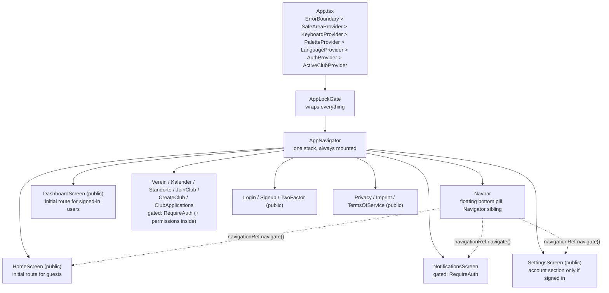
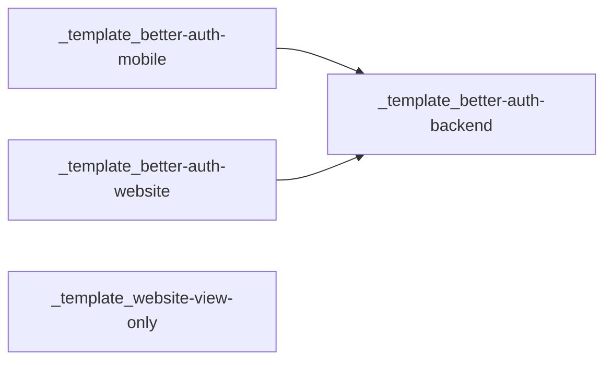

# Better Auth Mobile Template

An Expo/React Native app wired to `_template_better-auth-backend`'s Hono server. Like the website template, this app has no session store, no user table, and no auth logic of its own — every sign-in, sign-up, and session check is a real network call to the backend, using Better Auth's own Expo client.

It ships "browse first": a guest can open the app and look around before ever creating an account, and only hits a login wall when they try to do something that actually needs one. That pattern — not a route-level flag, but two small, reusable primitives — is the main thing this template adds on top of a working auth flow.

## Table of contents

- [Getting started](#getting-started)
- [Architecture](#architecture)
- [Guest mode](#guest-mode)
- [Adding a new API request](#adding-a-new-api-request)
- [Theming](#theming)
- [Color palettes & theming](#color-palettes--theming)
- [Keyboard handling](#keyboard-handling)
- [Adding a new popup](#adding-a-new-popup)
- [State and storage](#state-and-storage)
- [Screens](#screens)
- [Configuration](#configuration)
- [Security](#security)
- [Key decisions](#key-decisions)
- [Operations](#operations)
- [Testing and CI](#testing-and-ci)
- [How this fits into the template suite](#how-this-fits-into-the-template-suite)
- [License](#license)

## Getting started

```
npm install
cp .env.example .env   # point EXPO_PUBLIC_BACKEND_URL at a running _template_better-auth-backend
npm start
```

Then press `a` for Android, `i` for iOS, or `w` for web in the Expo CLI, or scan the QR code with Expo Go. The backend must already be running and reachable from wherever the app runs — on a physical device that means your machine's LAN IP, not `localhost`.

### Scripts

| Script | Purpose |
|---|---|
| `npm start` | Start the Expo dev server |
| `npm run android` / `npm run ios` / `npm run web` | Start and open a specific platform |
| `npm run typecheck` | `tsc --noEmit` |
| `npm run lint` | ESLint |
| `npm test` | Jest |

## Architecture



`AuthProvider` (`src/auth/AuthProvider.tsx`) is the single source of truth for auth state — every screen reads `useAuth()` rather than calling `authClient` directly, so `signIn`/`signUp`/`signOut`/`updateProfile`/`changePassword`/`listSessions`/`revokeSession`/`enableTwoFactor`/`disableTwoFactor`/`resendVerificationEmail`/`requestPasswordReset` all live in one place with one consistent `{ success, error? }` return shape. `AppNavigator` reads `isAuthenticated`/`twoFactorPending` from it to decide what's reachable, but never talks to `authClient` itself.

Layout:

```
src/
├── auth/            # AuthProvider, RequireAuth, Better Auth client, app-lock storage
├── clubs/           # ActiveClubProvider (GET /my-clubs + selected club), activeClubStorage, lastApplyClubStorage
├── components/       # Logo, Navbar, SignedInCard, ConnectionErrorScreen, KeyboardAwareScreen (react-native-keyboard-controller);
│                     #   AppLock/, Modals/, Settings/ (sub-components), ui/ (MonthCalendar, DateTimeField, FormSheet, SignedImage, BentoTile, FadeIn),
│                     #   forms/ (FormRenderer, AnswerList), verein/, kalender/, standorte/ (feature components)
├── contexts/         # i18n (translation/: LanguageContext + per-area translation tables, supportedLanguages, language storage)
├── error/            # ErrorBoundary
├── hooks/            # data hooks per feature (useMyClubs, useOwnMembership, useClubMembers, useClubApplications, useFormSubmission, useClubForm,
│                     #   useMyApplications, useExitRequests, useExitForm, useMemberCustomFields, useLocations, useEvents, ...), useRequireAuth, useAttemptLockout, useThrottledCallback
├── legal/            # Privacy/Imprint/TermsOfService screens, first-launch ToS modal
├── lib/              # api.ts (apiFetch<T> wrapper, see "Adding a new API request"), media.ts, formSchema.ts, serialQueue.ts, applicationReview.ts, customFields.ts, exitForm.ts, ...
├── navigation/       # AppNavigator (the one stack), navigationRef (imperative nav helper)
├── onboarding/       # IntroModal, introSeenStorage
├── screens/          # Home, Dashboard, Verein, Kalender, Standorte, JoinClub, CreateClub, ClubApplications, Notifications, Login, ForgotPassword, Signup,
│                     #   EmailVerification, TwoFactor, Settings, AppLock (rendered by AppLockGate, not a stack route)
├── settings/         # appSettingsStorage (Topbar/Navbar title toggles)
└── theme/            # colors.ts — the one place a JS-prop color is looked up; palettes, PaletteProvider, theme storage
```

## Guest mode

There is no split between a fully-public and a fully-authenticated navigator. The one auth-based branch is the initial route itself: guests land on `Home`, already-authenticated users skip straight to `Dashboard` (a placeholder landing screen — swap it for your real one) so a relaunch doesn't show a signed-in user the guest marketing screen first. Beyond that initial route — unlike earlier versions of this template — **no screen is gated by default** in the bare template, including `Settings`. The MyVerein club screens opt *in*: `AppNavigator` wraps `Verein`, `Kalender`, `Standorte`, `JoinClub`, `CreateClub`, `ClubApplications` and `Notifications` in `RequireAuth` (7 routes), while `Home`, `Dashboard`, `Login`, `ForgotPassword`, `Signup`, `EmailVerification`, `TwoFactor`, `Settings` and the legal screens stay public (permission-based gating inside the club screens goes through `useOwnMembership(clubId).can(...)`). `Settings` turned out to hold mostly guest-relevant content (language, theme, App Lock PIN, legal pages) alongside the handful of account-specific sections (profile, password, 2FA, sessions), so the screen itself is public; only those account sections inside it check `useAuth().isAuthenticated` and swap themselves for a sign-in/sign-up prompt when it's false. `AppLockGate` wraps the whole navigator unconditionally and stays inert until a PIN actually exists — guest or signed in, whoever sets one up locks the app the same way.

That said, `RequireAuth`/`useRequireAuth` are still here as the two conventions a real product reaches for once it *does* have something that needs a real session — `AppNavigator` uses `RequireAuth` for the seven club/notification routes above and `HomeScreen.tsx` uses `requireAuth(action)` for its Kalender/Standorte/Verein tiles; both are maintained, tested, and meant to be copied.

**Gate a whole screen** — wrap it in `src/auth/RequireAuth.tsx`:

```tsx
<RequireAuth>
  <SomeAccountOnlyScreen ... />
</RequireAuth>
```

Redirects to `Login` (with `returnTo` set to the current route) while `useAuth().isAuthenticated` is false, rendering `fallback` (or nothing) in the meantime. Use this for a screen with no meaningful guest view at all.

**Gate a single action on an otherwise-public screen** — call `src/hooks/useRequireAuth.ts`'s `requireAuth(action)`:

```tsx
const { requireAuth } = useRequireAuth();
<TouchableOpacity onPress={() => requireAuth(() => doTheThing())} />
```

Runs `action` immediately if signed in, otherwise redirects to Login with `returnTo` set to the current route. Use this for a public screen where only some actions actually need an account — this was `HomeScreen.tsx`'s original pattern for its placeholder feature cards, before those cards started pointing at the now-public `Settings` and the wrapper stopped making sense there.

### Adding a protected screen

1. Build the screen component under `src/screens/` as usual.
2. Decide whole-screen vs. single-action gating (see the two conventions above) and wire it accordingly. For a whole screen:
   ```tsx
   <RootStack.Screen name="Billing">
     {() => (
       <RequireAuth>
         <BillingScreen />
       </RequireAuth>
     )}
   </RootStack.Screen>
   ```
3. Add the route name to `RootStackParamList` in `src/navigation/AppNavigator.tsx` and register the `<RootStack.Screen>` inside `MainNavigator` (not `TwoFactorNavigator` — that stack is only ever mounted mid-login).
4. If the screen needs a permanent entry point rather than only being reached from another screen's button, add it to `NAV_ITEMS` in `src/components/Navbar.tsx` — it's a plain array (`{ route, labelKey, Icon }`), so this is one new entry, not a restructure. Note that `Navbar.tsx` itself can't use `useNavigation()`/`useRoute()`/`useRequireAuth()` (it's a `RootStack.Navigator` sibling, not one of its screens — see the comment in `src/navigation/navigationRef.ts`); a Navbar item that needs to gate itself should check `useAuth().isAuthenticated` directly and call the exported `navigate()` helper, the same way the Settings icon does today.
5. Every *other* screen (rendered as an actual `<RootStack.Screen>`, unlike `Navbar`) can use `useNavigation()`/`useRoute()`/`useRequireAuth()` normally — the restriction in step 4 is specific to `Navbar`.

## Adding a new API request

There's no data-fetching library here (no react-query, no SWR). `src/lib/api.ts`'s `apiFetch<T>` (added for the notification routes, see `src/hooks/useNotifications.ts` for a real example of both hook shapes below) is the one shared request helper — `src/screens/SettingsScreen.tsx`'s `DebugSection` still calls the backend's `GET /examples/ping` with a plain `fetch()` since it predates `apiFetch`, but any new route should go through `apiFetch` instead of copy-pasting `fetch()` calls.

**1. Confirm the backend route exists first.** Every path has to match a real route in `_template_better-auth-backend/src/routes/*.ts` — see that repo's README section "Adding a new API route" if it doesn't exist yet. A mismatched path fails at runtime with a 404, not a type error.

**2. The typed fetch wrapper, `apiFetch<T>` in `src/lib/api.ts`, already exists — reuse it.** It's built on `authClient.$fetch` (from `src/auth/auth-client.ts`) so the session cookie is attached automatically — never add an `Authorization` header by hand — and have it throw a small `ApiError` (`status`/`code`/`details`) on any non-2xx response, matching the backend's `AppError` shape. Inside `apiFetch`, always call `$fetch` with an *absolute* URL (`` `${backendUrl}${path}` ``, importing `backendUrl` from `auth-client.ts`), never the bare `path` callers pass in: `authClient` is configured with `baseURL: backendUrl`, but better-auth's client resolves a relative path against `${backendUrl}/api/auth` (its own routes' base, see `withPath()` in better-auth's `client/utils/url.ts`), not `backendUrl` itself. A bare `/profile/me` silently resolves to `/api/auth/profile/me` — a path Better Auth's own handler doesn't recognize, so it 404s with an empty, non-JSON body instead of your actual route's response. Callers themselves keep passing bare paths — `apiFetch` is the one place that prepends `backendUrl`, so nothing above it has to think about this:

```ts
apiFetch<{ data: Profile }>('/profile/me');
apiFetch<{ data: Profile }>('/profile/me', { method: 'PATCH', body: input });
```

**3. Add the call to a hook, not to a screen.** Screens shouldn't call `apiFetch` (or `fetch`) directly once there's more than the one-off debug ping — put each request behind a `useXxx.ts` hook under `src/hooks/`, in whichever of these two shapes fits:

- **Fetches data on mount** — `useState` for the data/loading/error, a `useCallback`'d `refetch`, and a `useEffect` that calls it once:

```ts
export function useWidgets() {
  const { isAuthenticated } = useAuth();
  const [widgets, setWidgets] = useState<Widget[]>([]);
  const [loading, setLoading] = useState(isAuthenticated);
  const [error, setError] = useState<string | null>(null);

  const refetch = useCallback(async () => {
    if (!isAuthenticated) { setWidgets([]); setLoading(false); return; }
    setLoading(true);
    setError(null);
    try {
      const { data } = await apiFetch<{ data: Widget[] }>('/widgets');
      setWidgets(data);
    } catch (err) {
      setError(err instanceof Error ? err.message : 'Failed to load widgets');
    } finally {
      setLoading(false);
    }
  }, [isAuthenticated]);

  useEffect(() => { void refetch(); }, [refetch]);

  return { widgets, loading, error, refetch };
}
```

  Guard on `useAuth().isAuthenticated` (from `src/auth/AuthProvider.tsx`) whenever the backend route itself requires a session — check the route's `sessionGuard` usage in the backend to know which.

- **Writes data on demand** — no state, no `useEffect`, just `useCallback`-wrapped functions that return the `apiFetch` promise directly and let the caller decide what to do with the result:

```ts
export function useWidgetMutations() {
  const createWidget = useCallback(
    (input: CreateWidgetInput) => apiFetch<{ data: Widget }>('/widgets', { method: 'POST', body: input }),
    [],
  );
  return { createWidget };
}
```

  Mutation hooks don't gate themselves — the screen calling them wraps the button press in `useRequireAuth()`'s `requireAuth(action)` (see [Guest mode](#guest-mode)) or lives inside a `RequireAuth`-wrapped screen.

**4. Call the hook from the screen.** `const { widgets, loading, refetch } = useWidgets();` — same as any other hook, no special wiring.

**5. Type the response, don't guess it.** `apiFetch<{ data: T }>` should match the backend handler's `return c.json({ data: ... })` shape exactly. If the backend returns `void` (most `DELETE` routes), type it `apiFetch<void>(...)`.

That's the whole loop — confirm the backend route → (once) add the `apiFetch` wrapper → add a call to a hook (fetch-shaped or mutation-shaped) → call the hook from a screen. No new dependency; `apiFetch` plus the two hook shapes above cover every request a real project built on this template ends up making.

## Theming

Two independent axes: **light/dark mode** (unchanged, see below) and a
**color palette** layered on top (predefined or custom, see [Color palettes
& theming](#color-palettes--theming)).

Dark mode defaults to the OS setting (`app.json`'s `userInterfaceStyle: "automatic"`, Tailwind's `darkMode: 'media'`) but can be overridden per-user from Settings' Appearance section, via NativeWind v4's own `colorScheme.set('light' | 'dark')` / `useColorScheme()` (`import { colorScheme, useColorScheme } from 'nativewind'`) — no custom theme context needed, `darkMode: 'media'` in `tailwind.config.js` stays as-is since NativeWind's runtime override works independently of that setting.

App icon, splash screen, and adaptive icon layers are all rasterized from the same LPJ IT-Solutions mark used by the website templates (`assets/icon.png`, `assets/splash-icon.png`, `assets/android-icon-*.png`). `src/components/Logo.tsx` renders it inline on `LoginScreen`, `SignupScreen`, and `HomeScreen`.

**On Android (edge-to-edge by default on this SDK), the system status/nav bars have no background-color API at all anymore** — Google removed it; the bars are permanently transparent, and whatever shows through them is whatever the app itself renders at those coordinates. There is no bar-level fix for this; see the two notes below for where that color actually comes from. `react-native-edge-to-edge`'s unified `SystemBars` component would be the modern, one-component way to also control both bars' icon color, but its native module isn't compiled into Expo Go on this SDK (confirmed by a runtime crash, `RNEdgeToEdge could not be found`) — needs a dev client. Testing via a dev client (`expo run:android`) can also hit an unrelated, still-open Metro/OkHttp bug where the JS bundle download corrupts mid-transfer ([facebook/react-native#56034](https://github.com/facebook/react-native/issues/56034)) — if you see a white screen after the splash with no red-box error, check `adb logcat` for `ChunkedSource.readChunkSize`; a corporate antivirus/EDR doing HTTP inspection on localhost traffic is the most common cause.

**Android status bar / system nav bar background follows the theme via `contentStyle`, not `SafeAreaView`.** `@react-navigation/native-stack` screens default their `contentStyle` background to white, which is unrelated to (and drawn behind) each screen's own themed `SafeAreaView`. `AppNavigator.tsx`'s two `RootStack.Navigator`s set `screenOptions={{ contentStyle: { backgroundColor: themeColors.background } }}` for exactly this reason — a per-screen fix wouldn't be enough since it's a navigator-level default.

**Background color for both bars also needs `NavigationContainer`'s `theme` prop, not `contentStyle` alone.** `@react-navigation/native`'s `NavigationContainer` renders its own root view with a `theme.colors.background` that defaults to a hardcoded white (`DefaultTheme`) if you never pass a `theme` — and that root sits beneath the entire navigator/screen tree, so its white shows through anywhere `contentStyle` doesn't reach. `src/theme/colors.ts`'s `useNavigationTheme()` builds a `Theme` from the same tokens as `useThemeColors()` (spread over React Navigation's own `DefaultTheme`/`DarkTheme` for the parts this app doesn't customize, like `fonts`), and `AppNavigator.tsx` passes it to `<NavigationContainer theme={...}>`.

**`expo-status-bar` + `expo-navigation-bar` for system bar icon color.** `<StatusBar style="auto" />` in `App.tsx` (cross-platform). `expo-navigation-bar` at this SDK is the older imperative API (`import * as NavigationBar from 'expo-navigation-bar'`, `NavigationBar.setStyle('auto')` — no JSX component), Android-only, called once on mount alongside the theme-restore effect.

## Color palettes & theming

Users can switch between a few predefined color palettes, or build a custom
one, from **Settings → Appearance**. This layers on top of dark/light mode
(unaffected, see [Theming](#theming) above) — each palette defines its own
light *and* dark token set.

**The mechanism (NativeWind v4's `vars()`):** NativeWind normally compiles a
`className` like `bg-card` to a fixed hex value at build time, which is why
this app used to pair every color class with a `-dark` variant (`bg-card
dark:bg-card-dark`) instead of a single runtime-swappable variable, the way
the website's `globals.css` does. `vars()` (from `nativewind`) removes that
limitation: `tailwind.config.js`'s colors now read
`rgb(var(--color-card) / <alpha-value>)` instead of a literal hex, and
`PaletteProvider.tsx` injects the actual "R G B" values at runtime via a
root-level `<View style={vars({...})}>` in `App.tsx`. Existing `bg-card
dark:bg-card-dark`-style classNames elsewhere in the app didn't need to
change at all — they just resolve a runtime value now instead of a
build-time constant. The RGB-triplet form (not hex) is required to keep
Tailwind's opacity modifiers working (`bg-primary/10`, used in
`IntroModal.tsx`) with a CSS-var color.

| Piece | File | Role |
|---|---|---|
| Palette registry | `src/theme/palettes.ts` | `palettes` — a `Record<paletteId, { label, light, dark }>` of predefined palettes (`ink-navy`, `ocean`, `forest`, `sunset`). `ink-navy` is the default |
| Runtime application | `src/theme/PaletteProvider.tsx` | Wraps the whole app (`App.tsx`, above `AppNavigator`). Computes the active token set, converts each color to an "R G B" triplet, and injects it via `vars()` on a root `View`. Persists the chosen palette id + custom colors to `AsyncStorage`. Exposes `usePalette()` (`paletteId`, `setPaletteId`, `customAnchors`, `setCustomAnchors`, resolved `tokens`) |
| Custom palette derivation | `src/theme/deriveTokens.ts` | Pure function: 3 anchor colors (background/foreground/primary, one set per mode) → a full token set, mixing card/muted/border from the anchors. Same formula as the website's `deriveTokens.ts`. No WCAG contrast enforcement — deliberate, see the vault's `ADR-008` |
| Persistence | `src/theme/paletteStorage.ts` | `AsyncStorage`, keys `_template_better-auth-mobile.color-palette-id` / `.color-palette-custom` — same convention as `themePreferenceStorage.ts` |
| Custom palette UI | `src/components/Settings/PaletteCustomEditor.tsx` (rendered from `SettingsScreen.tsx`'s Appearance section) | 6 swatches (light/dark × background/foreground/primary); tapping one opens a bottom-sheet [`reanimated-color-picker`](https://alabsi91.github.io/reanimated-color-picker/) (hue slider + saturation/brightness panel), committed via `onCompleteJS` when the gesture ends — React Native has no built-in color picker like the web's `<input type="color">` |
| JS-prop colors | `src/theme/colors.ts` | `useThemeColors()` / `useNavigationTheme()` now read the active palette via `usePalette()` instead of a fixed `colors.light`/`colors.dark` object — still the only place `ActivityIndicator`/icon-`color`/`Switch` props should import a color from. `destructive`/`success` stay fixed regardless of palette (danger/success shouldn't drift with the accent) |

**Adding a new predefined palette:** add an entry to `palettes` in
`src/theme/palettes.ts` with a `label`, `light`, and `dark` token set — the
`TokenSet` type requires every key. Shows up in Settings automatically, no
other file to touch (no `tailwind.config.js` edit needed — it already reads
every token through a CSS variable).

**Changing the default palette's colors:** edit `palettes['ink-navy']` in
`src/theme/palettes.ts` — that's the *only* place, unlike the website
template (which also has to keep `globals.css` in sync, since a website has
a pre-JS first paint; this app has no such SSR-equivalent moment, so there's
nothing else to update).

**Dependency note:** the custom-color picker pulled in two packages,
`reanimated-color-picker` and its peer dependency `react-native-gesture-handler`
(the only place in this app that needs gesture-handler — navigation uses
`@react-navigation/native-stack`, which doesn't). `App.tsx` wraps the whole
app in `GestureHandlerRootView` for this reason; if that wrapper ever gets
removed, the color picker's pan gestures silently stop responding.

`expo-localization` is used by `systemLanguage.ts` to read the device's
locale list for system-language detection at app start (see
`defaultLanguage` above and [Configuration](#configuration)) — the official
Expo module for this, not a hand-rolled `NativeModules` read.

## Keyboard handling

Wrapping is opt-in per screen, not automatic. `App.tsx`'s `KeyboardProvider` only makes the mechanism available app-wide — it doesn't apply it to anything by itself, so a screen built without the wrapper below behaves exactly like it would without the library installed.

Any new screen or modal with a `TextInput` needs one of these two, picked by how it renders:

- **Screen** (`src/screens/`) — wrap the returned tree in `KeyboardAwareScreen` (`src/components/KeyboardAwareScreen.tsx`) instead of `SafeAreaView`/`ScrollView`. See `LoginScreen.tsx`.
- **Modal** (`src/components/Modals/`) — use `react-native-keyboard-controller`'s `KeyboardAwareScrollView` directly instead of `KeyboardAvoidingView`. `Modal` renders outside the navigator tree, so a screen's `KeyboardAwareScreen` wrapper never reaches into it — see `_template_mobile-view-only`'s `SetupPinModal.tsx` for the pattern.

A screen with no `TextInput` doesn't need either — the default `SafeAreaView` is fine, there's nothing for the keyboard to cover. See [Key decisions](#key-decisions) for why this library over a hand-rolled `KeyboardAvoidingView`.

## Adding a new popup

`src/components/Modals/` has two shapes, pick by content length rather than by copying whichever one is closest to hand:

- **Short, fixed content** (a title, a one-line message, up to two buttons — nothing fetched, nothing that can grow) — `ConfirmationModal` / `ConfirmationInputModal` / `InfoModal`. These are `justify-center items-center`, no `ScrollView`, no `maxHeight`; the card just sizes to its content and stays centered. Safe to reuse as-is for anything shaped like a yes/no or single-input dialog.
- **Anything longer, or with more than a couple of scrollable sections** — the bottom-sheet shape used by `IntroModal` (`src/onboarding/IntroModal.tsx`) and `AcceptTosModal` (`src/legal/AcceptTosModal.tsx`): a `justify-end` container holding a card with an inner `ScrollView`. There's no generic wrapper component for this shape yet (only two callers exist) — copy one of those two rather than inventing a third variant if a project ends up needing several.

**Bottom-sheet height gotcha:** a bottom-anchored card (`justify-end` container) must bound its height using `useWindowDimensions()` and `useSafeAreaInsets()`, never a flat percentage like `maxHeight: '85%'`. React Native's Yoga layout doesn't clip a flex child that overflows its container, so on a short-screen device (or with tall content) `85%` of screen height plus whatever bottom clearance the card also reserves can add up to more than the screen height — pushing the card's top edge above `y = 0`, i.e. rendered behind the status bar/notch, invisible on that device. Both `IntroModal` and `AcceptTosModal` compute it instead:

```ts
const insets = useSafeAreaInsets();
const { height: windowHeight } = useWindowDimensions();
const topClearance = insets.top + 12;
const maxCardHeight = Math.min(windowHeight * 0.85, windowHeight - topClearance - navbarClearance);
```

`navbarClearance` is whatever the card's own `marginBottom` reserves to clear the floating pill navbar (both of these do, since they render inside the main app shell). If a new bottom sheet renders somewhere without that navbar below it, drop the `navbarClearance` term and just use `windowHeight - topClearance`. The `* 0.85` term stays as an upper ceiling so the card doesn't stretch to fill the whole screen on a tall device — the fix only tightens the bound on short ones, it never removes the cap.

## State and storage

There is no local database and no domain data model — the only things persisted on-device are:

| What | Where | Notes |
|---|---|---|
| Session token | OS keychain/keystore via `expo-secure-store` | Managed entirely by `@better-auth/expo`'s `expoClient` plugin, not hand-rolled |
| App Lock PIN | OS keychain/keystore via `expo-secure-store` | `src/auth/appLockStorage.ts`, key prefixed `_template_better-auth-mobile.app-lock-pin` |
| UI language | `AsyncStorage` | `src/contexts/translation/languagePreferenceStorage.ts`, key `_template_better-auth-mobile.language` (any id from `supportedLanguages.ts`'s registry); read once on `LanguageProvider` mount, written on every `setLanguage` call |
| Theme (dark/light) | `AsyncStorage` | `src/theme/themePreferenceStorage.ts`, key `_template_better-auth-mobile.theme`; applied via NativeWind's `colorScheme.set()` once on `App.tsx` mount, written whenever Settings' Appearance toggle changes it |
| Color palette | `AsyncStorage` | `src/theme/paletteStorage.ts`, keys `_template_better-auth-mobile.color-palette-id` / `.color-palette-custom`; read once on `PaletteProvider` mount, written whenever Settings' Appearance palette picker changes it — see [Color palettes & theming](#color-palettes--theming) |
| Show titles in Topbar / Navbar | `AsyncStorage` | `src/settings/appSettingsStorage.ts`, keys `_template_better-auth-mobile.show-topbar-titles` / `.show-navbar-titles`; each read once on mount (`Navbar.tsx`, Settings' `loadSettings` effect) rather than subscribed to reactively — both toggles require an app restart to take effect, which is why flipping either shows an "App Restart Required" `InfoModal` |
| Active club | `AsyncStorage` | `src/clubs/activeClubStorage.ts`, key `_template_better-auth-mobile.active-club-id` (club id only); read once on `ActiveClubProvider` mount, written by `setActiveClubId`, cleared on sign-out. Falls back to the first membership if it no longer matches |
| Last application club | `AsyncStorage` | `src/clubs/lastApplyClubStorage.ts`, key `_template_better-auth-mobile.last-apply-club-slug` (club code only, public, no answers); read once on `JoinClubScreen` mount to prefill the code field (typing first wins), written after a club's form loaded successfully |
| Intro seen | `AsyncStorage` | `src/onboarding/introSeenStorage.ts`, key `_template_better-auth-mobile.intro-seen` (`'1'`); whether the first-launch `IntroModal` was dismissed (removed again when reset) |
| Terms accepted | `AsyncStorage` | `src/legal/tosAcceptanceStorage.ts`, key `_template_better-auth-mobile.tos-accepted` (`'1'`); whether the first-launch terms modal on `Home` was accepted (shown before the intro until accepted) |

Profile photos (Wave 7 M6) add **no persisted state and no stored URL**: `photoUrl` is a short-lived signed URL delivered inside the member resource (`GET /club-members/me`, `GET /club-members`), shown with a plain `Image`; `null` shows initials. `MemberAvatar` reports an image load error once (`onExpired`) and the owner refetches the resource for a fresh signature (MembersTab throttles this to once per 10 s); a second failure keeps the initials. Upload: `PUT /club-members/me/photo` (or `/:id/photo` with `members:write`), multipart field `file`, via `uploadMemberPhoto` in `src/lib/media.ts` (native `File.upload` with `httpMethod: 'PUT'`); remove: `DELETE`. Square crop and upright rotation come from the picker's own editor (`allowsEditing`, `aspect: [1, 1]`, `quality: 0.8`) — no `expo-image-manipulator` is installed; the backend strips EXIF/GPS and does not re-encode. `403` on the own photo means a minor (the board sets it; the UI hides the edit controls when the known birth date is under 18). The `expo-image-picker` config plugin in `app.json` carries the camera/photo permission texts (English default; German via `locales/de.json` / `locales/en.json` InfoPlist strings; the texts also name damage reports, club-founding proofs and membership applications (profile photo, attached photos), which use the library/camera too). A picker-output file in the app cache is deleted after the upload; an upload result for another club/member than the one open (or after leaving) is dropped.

**Media (Wave 7 B18).** The app never persists or builds media URLs and has no `GET /media/<key>` client. Uploads go through `uploadMedia(clubId, asset)` in `src/lib/media.ts` (`POST /media?clubId=`, multipart `file`, JPEG/PNG/WebP, 10 MB checked client-side first; native `File.upload` with the session cookie; picker output in the app cache is deleted afterwards) and yield `{ key, url, mimeType, sizeBytes }`; only the `key` is sent on as `photoKey` (locations create/PATCH, `null` removes; damage reports). `useImageUpload` wraps pick (camera/library) + upload with a stale-result token. Display uses the signed absolute `photoUrl` from the feature response with a plain `Image` (`components/ui/SignedImage.tsx`): on a load error it signals once (`onExpired`), the owner refetches (`useThrottledCallback`, at most once per 10 s; Orte list/detail and the Material detail), and a second failure shows the placeholder. Failures map through `imageUploadFailureKey` / `apiErrorMessage` (`QUOTA_EXCEEDED` → storage limit, `TOO_MANY_REQUESTS` → wait, 422 → unusable image). Uploads are stored unattached until a feature route claims the key; per user at most 25 unsaved files / 50 MB are allowed (cleaned up after 24 h) -- the backend marks that with `details.code = 'unattached_cap'` (own message), club storage with `club_quota` (storage-limit message). A replaced or removed not-yet-saved photo simply drops its key in the form. If a save with a `photoKey` fails without a server answer and the retry gets 422 "Unknown media key", the list is reloaded and a "may have been saved" notice is shown instead of "invalid". No client-side MIME whitelist (empty/`image/jpg` normalised, the backend decides). Club-registration proof documents keep their own private route.

Key management (Wave 7 M7) adds **no persisted state**: holders come with `GET /locations/:id` (`useLocationDetail`, race-safe, keyed per club+location), the history is fetched per location into hook state (`useKeyHistory`, `requestId` guard, 403 hides the section), issue/return go through `useLocationMutations` (`POST/DELETE /locations/:id/key-holders`); holder names come from `keyHolders[].memberName`, else the history, else "Unknown member"; the picker uses `useMemberSearch`. A failed reload after issue/return shows an inline "may be outdated" hint with retry.

Exit requests (Wave 7 M2) and the Verwaltung tab add **no persisted state**: requests, notice preview and the queue are fetched per club into hook state (`useMyExitRequests`, `useExitRequestQueue`) and dropped on club switch; the visible tabs derive from `permissions` of `GET /club-members/me`.

**Form renderer (Wave 8 M1).** `src/components/forms/FormRenderer.tsx` is the reusable, controlled renderer of the club's configurable forms (`GET /club-forms/:clubSlug/aufnahme`, later the exit form and custom fields): all field types (`text`, `textarea`, `number`, `date`, `select`, `multiselect`, `checkbox`, `consent`, `file`, `image`, `info`), `visibleIf`, per-field error lines (`accessibilityRole="alert"`), required fields announced in the accessibility label, 44 pt touch targets, Dark mode via the theme classes, no new dependency. The caller owns `answers`/`files` and talks to the backend. Rules: (1) every text of a definition (label, help, options, privacy notice, info text) is rendered as a plain `Text` -- no markup/HTML path; (2) the privacy notice is a prominent block (shield icon, bordered) right above the first visible consent, which itself is a bordered block; (3) `date` uses the existing `DateTimeField` (`YYYY-MM-DD` answers via `toDateString`/`fromDateString`); `number` keeps unfinished input and accepts a decimal comma; `select` shows radio rows up to 6 options and a bottom-sheet list above; text inputs sit inside `KeyboardAwareScreen` (the caller's screen) and expose `handleRef.focusField(key)`; (4) **photos only**: `image` fields (system square crop) and `file` fields use `expo-image-picker` (camera or system photo picker -- the library needs no permission request, only the camera asks; JPEG/PNG, `file` fields JPEG/PNG only, `image` also WebP, 10 MB checked client-side first); there is no document picker, so a `file` field shows a hint that PDF documents can only be uploaded on the website (plan open point O5; a dependency would need approval). Uploads go through `uploadSubmissionFile` in `src/lib/media.ts` (`POST /form-submissions/:id/files`, multipart `file` + `fieldKey`, native `File.upload` with the session cookie, progress, cancel via `AbortSignal`, cancelled only after 60 s **without progress** so a big photo on a slow line completes, picker output in the app cache deleted afterwards -- and also on every path where no upload starts: client-side rejection, aborted before the request, unmounted, draft could not be created (`discardPickerFile`, only ever deletes inside the app cache)); the backend registers the file in the media layer, the app keeps no key and no URL -- the signed preview `url` of a stored photo lives in component state only and an expired one triggers `onFilesExpired` once (the owner reloads the submission). Known limit: if Android kills the app while the camera is open, the captured photo is lost (no `getPendingResultAsync` recovery, because the form state of that field is gone anyway) -- the person takes it again. Accessibility: controls that carry their own label/hint (text, number, select) hide the visible label from screen readers so it is not announced twice; cancel/remove/error entries have 44 pt hit areas. Pure logic (ported 1:1 from the website, with tests): `src/lib/formSchema.ts` (field types, `visibleIf`, client mirror of `validateAnswers`, answer diff/patch for the autosave, re-pin helpers `carryAnswers`/`mergeConcurrentEdits`/`lostEntryLabels`, `formErrorKey` mapping every backend error code onto a `forms.err.*` text with `apiErrorKey` as the fallback) and `src/lib/serialQueue.ts` (jobs one after another). Texts live in `src/contexts/translation/FormsTranslation.ts` (DE/EN, other languages alias English; a Jest test keeps the key sets and placeholders identical).

**Application flow state (Wave 8 M2).** The flow adds **no persisted state**: no answer, photo, key or URL is written to AsyncStorage, SecureStore, a cache or a log -- the draft is the server's `form_submissions` row, the only copy on the device is React state while the screen is open (picker output in the app cache is deleted after the upload). `useFormSubmission` (`src/hooks/useFormSubmission.ts`): all requests that change the draft (create, patch, re-pin, submit, discard) run through `createSerialQueue`, so a slow save never overtakes a newer one; the diff against what the server stored (`diffAnswers`, `null` removes a key) is the autosave body, answers the server refused (`422 details.fields`) are flagged on the field and not resent until changed; unsaved typing is flushed when the form goes away (mode switch, other club); a lost upload response (network, timeout, abort) re-reads the draft's files instead of guessing. `useClubForm` (`src/hooks/useClubForm.ts`) is slug-aware with a sequence guard: only the newest load writes state. `KeyboardAwareScreen` takes an optional `scrollRef` (the screen scrolls back to the top when the "Antrag eingereicht" banner appears).

**Application review state (Wave 8 M3/M5).** The review adds **no persisted state**: list and detail live in hook state keyed by club (+ application), only the newest request may write (`requestId` guard; a club switch, page change or decision invalidates older fetches), a failed reload keeps the old rows and shows a retry. Applicant answers, consent evidence and photos are never logged or cached beyond the open sheet; the only on-disk copy is the temporary image file described in the Screens table, removed when it is no longer shown. `ClubPermission` knows `forms:write` (backend Wave 8) for later gating of the form editor; the review itself is gated by `members:write`.

**Custom fields and exit form (Wave 8 M4).** No new persisted state. `useMemberCustomFields(clubId, target)` (`src/hooks/useMemberCustomFields.ts`) loads `GET /club-members/me/custom-fields` (`target = 'me'`) or `GET /club-members/:id/custom-fields` and keeps the data together with its club + member (`requestId` race guard: a late answer after a club/member switch is dropped, values of one person never show on another's sheet); 403/404 mean "no custom fields" (guests, unreadable record) and render nothing; `save(values)` is `PATCH /club-members/me/custom-fields` with only the changed editable keys (cleared = `null`), the answer replaces the view; other members are never written from the app. `useExitForm(clubId, enabled)` (`src/hooks/useExitForm.ts`) loads the published `austritt` form (`GET /club-exit-requests/form`) only while the cancellation sheet is open. Pure helpers are ports of the website's: `src/lib/customFields.ts` (partition editable/read-only, `valuesPatch`, `displayValue`, `customFieldErrorKey`) and `src/lib/exitForm.ts` (`exitRequestBody`: date + answers of visible fields + `formVersionId`, **no separate reason**; `exitFormFields` hides file/image fields (the sheet has no upload, a required one never blocks the cancellation); `plainExitBody`; `repinExit` for `409 FORM_VERSION_OUTDATED` (without a current form the form is reloaded and a notice shown); `exitDialogTouched`). Answers and custom field values live in component/hook state only; they are never logged, cached or written to AsyncStorage, and the exit answers are dropped when the sheet closes. Texts: `forms.cf.*` / `forms.exit.*` in `FormsTranslation.ts` (DE/EN identical keys).

None of the above needs `expo-secure-store` — language, theme, and the two title toggles are non-sensitive UI preferences, so plain `AsyncStorage` is the right tool; only the session token and App Lock PIN go through the keychain. Everything else — user profile, sessions list, 2FA state — is fetched from the backend on demand through `AuthProvider`, never cached locally beyond React state.

**Supported languages:** `src/contexts/translation/supportedLanguages.ts` is the single registry (`id`/`label`/`nativeLabel`/`isRTL`) both this app and `_template_better-auth-website` derive their `Language` union from — German, English, French, Spanish, Portuguese, Italian, Dutch, Polish, Russian, Japanese, and Chinese (Simplified), all LTR (`isRTL: false` for every entry; Arabic/RTL is a deliberately separate future scope, see the vault's `ADR-009`). `t()` falls back to the English value for any key missing in the active language instead of showing the raw key. `LegalTranslation.ts` stays German/English-only by design — `LegalDocumentLayout.tsx` shows a visible banner when it falls back to English there.

## Screens

| Screen | Access | Purpose |
|---|---|---|
| `Home` | public | Initial route for guests. Compact header plus a Bento grid of Kalender/Standorte/Verein tiles (gated via `requireAuth`) and a sign-up/login CTA tile; signed-in users see the shared signed-in-as card |
| `Dashboard` | public | Initial route for already-authenticated users. Bento home: next upcoming Termin, plus Vorstand shortcuts shown by `club-members/me` permissions |
| `Verein` | gated (`RequireAuth`) | Tabs: Vereinsinfo (board/departments/documents), Mitglieder (`MembersTab`: paged list for everybody with `MemberAvatar` (photo or initials), board extras below; with `members:write` the detail sheet sets/removes a member's photo, also for minors and members without an account), Profil (`ProfilTab`, starts with the profile photo (`MemberPhotoEditor`, see below); self-service Selbstauskunft: birth date via `DateTimeField`, address, phone, contact e-mail, emergency contact; validation postal code 3-12 chars + e-mail format; only changed fields are PATCHed, cleared text fields as `""`, cleared contact e-mail / birth date as `null`; no full-screen spinner or overwrite of fresh input on the post-save refetch; "Änderungen verwerfen" confirmation and a confirmation when leaving the tab, switching club or navigating away (`beforeRemove`) while inputs are unsaved; below the profile card the **"Zusatzangaben"** card (`MemberCustomFields`, own custom fields via `GET/PATCH /club-members/me/custom-fields`: fields with `editable_by = self` are inputs rendered by `FormRenderer`, everything else (incl. board-maintained fields, even for a user with `members:write`) read-only with a hint with option labels and a "Geschützt" lock marker for `sensitive` fields; only changed values are PATCHed, 422 `details.fields` shown per field, plain German/English error texts; hidden for guests/403 and when no field is visible; unsaved values count for the leave-tab guard). The **"Mitgliedschaft"** card's cancellation sheet renders the club's `austritt` form with `FormRenderer` (client validation, answers + `formVersionId` sent, `FORM_VERSION_OUTDATED` re-renders the new form keeping answers by key and names dropped ones, loading/error/retry; after a failed retry "Ohne Formular kündigen" sends the cancellation with just the optional date and a plain `reason`, so the right to cancel never depends on the form endpoint; discard confirmation). The member detail sheet (Mitglieder tab) additionally shows the member's custom fields **read-only** whenever the server returns any for the caller (visibility is decided by the backend, e.g. `funktionstraeger` fields for Funktionsträger; 403/404/none = no card; board editing stays on the website); the Verwaltung exit queue's decision sheet shows the submitted exit answers (`AnswerList`; protected answers the caller may not read show "Geschützt").). Shows a "join a club" prompt if the caller has no membership yet |
| `JoinClub` | gated (`RequireAuth`) | Digital membership application (Wave 8 M2), reachable from `Verein`'s no-club state. Enter the club code -> the screen loads that club's own application form (`GET /club-forms/:slug/aufnahme`) and the caller's own submissions (`GET /form-submissions/mine`) and renders the form with `FormRenderer` (privacy notice + consent block, photo upload, plain-text labels). The draft lives **on the server only** (created with the first answer/photo, `PATCH` merge, debounced 800 ms through a serial queue; "Entwurf gespeichert" status line), "Entwurf verwerfen" deletes it (`DELETE /form-submissions/:id`, 204). "Aufnahmeantrag senden" validates client-side (convenience, the server decides), then `POST /form-submissions/:id/submit`; the applicant is NOT a member afterwards: the screen shows "Antrag eingereicht" and lists the open applications as "Wartet auf Entscheidung" with "Antrag zurückziehen" (`POST .../withdraw`, confirm via `Alert`). Submit and discard wait while a photo is uploading (hint shown, buttons disabled). Backgrounding the app saves the draft at once and coming back retries a failed save. A child application needs a verified e-mail address: if the session says `emailVerified === false` (or the server answers `403 email_not_verified`) the child mode shows a warning block instead of the form with "Bestätigungs-E-Mail senden" (`resendVerificationEmail`), "Ich habe bestätigt" (re-reads the session) and a link to the self mode. A club publishing a new form version while the person types (`409 FORM_VERSION_OUTDATED`) re-pins the draft (`PATCH {formVersionId}`), keeps the answers per key and shows a notice naming the answers that had no place in the new form. **Kind-Antrag:** only if the form says `childApplication`, a "Für mich selbst / Für mein Kind" switch (`onBehalfOf: self|guardian`, separate draft and application) with hint texts about data, consent and account; submit warnings (`child_is_adult`, `birth_date_missing`, `child_name_matches_guardian`) are shown after filing. Errors: `ALREADY_MEMBER` / `APPLICATION_PENDING` show their own result card; every other code (`FORM_VERSION_OUTDATED`, `draft_limit*`, `child_application_*`, `email_not_verified`, `guardian_not_active`, `member_rejoin_blocked`, `form_required`, `QUOTA_EXCEEDED` `club_quota`/`unattached_cap`, `422 details.fields` per field) maps to a localised `forms.err.*` text via `formErrorKey` (`src/lib/formSchema.ts`, fallback `apiErrorMessage`); server messages never reach the UI. The old category picker is gone (the legacy apply is `409 form_required`). Hooks: `useClubForm` (load by code, race-safe via a sequence number, club stays on screen when a reload fails), `useFormSubmission` (draft state machine); component `components/verein/ApplicationForm.tsx` **Status area** (`MyApplicationsStatus`, data from `useMyApplications` = `GET /form-submissions/mine` across all clubs, shown on the code-entry step and reloaded when returning to it): open applications (draft / waiting) with a **Fortsetzen** button that opens the club and resumes the newest open draft of that club + mode (no retyping of the club code, and no second draft next to it); recent decisions (max 3 per club, max 90 days, `lib/applicationStatus.ts`): *rejected* shows "Nachricht des Vereins" (`decisionNote`, plain selectable `Text`, Berlin date; internal notes are never sent by the backend), *accepted* points to the Verein tab (the shared club list from `ActiveClubProvider` is refetched when an accepted decision is listed, and `VereinScreen` refetches on every refocus, so the club is there without a manual reload), *withdrawn* is neutral; "Neuen Antrag stellen" is offered after rejection/withdrawal. The last club code used is prefilled (see State and storage). |
| `CreateClub` | gated (`RequireAuth`) | Wave 6 club registration, entry via `Verein`'s no-club state ("Verein gründen"). Wizard: (1) club data, legal form drives register fields (`e_v` requires court + register number), (2) proof upload from the photo library (type per file, delete, per-file errors; max 5 files / 10 MB; JPEG/PNG only -- no document picker is installed, so no PDF), (3) summary + own board role (`vorsitz`/`stellv_vorsitz` only; `schriftfuehrer` was removed in Wave 7 B16 because its approval needs `roles:write`, an old draft with it falls back to `vorsitz`) + "authorised, data correct" checkbox -> submit. Slug is never asked (generated after approval). Server-side draft (`POST`/`PATCH /club-registrations`), uploads via `uploadRegistrationDocument` (`POST /club-registrations/:id/documents`, multipart `file` + `kind`). Status view for the newest registration (`GET /club-registrations/mine`): pending, needs_info (review note + edit + resubmit), rejected (reason + start new), approved (club slug; button returns to `Verein`, which reloads its clubs on focus). `Verein`'s no-club state also shows that status card. Data/race guard in `useClubRegistration` |
| `ClubApplications` | gated (`RequireAuth`) + `members:write` | Board review of open join applications (Wave 8 M3, "Vorstand light"; editing the form stays on the website). Paged list (`GET /club-applications?clubId=&page=&pageSize=`, 20 per page, Zurück/Weiter, empty/error-with-retry states, pull-to-refresh): one card per application with the answer summary, child badge (who filed it for whom), file count and consent state; tapping a card opens the **review sheet** (`ApplicationReviewSheet`, full-screen modal, `GET /club-applications/:id?clubId=`): applicant and subject (age band), warnings and duplicate hints, answers rendered against the form version the person filled in (answers the caller may not read without `members:read_sensitive` arrive redacted and show a lock), files, consent evidence (who, when, privacy notice shown, form version + text hash), mapping preview ("wird übernommen als ..."), and the decision: **Annehmen** (optional category override from `GET /club-members/categories`, default = the applicant's wish; `POST .../approve {categoryId?}`) or **Ablehnen** with two separate texts -- a message to the applicant (`applicantMessage`, the only text they see) and an internal note (`note`, board only) (`POST .../reject`). Taps: Verein -> Verwaltung -> Anträge -> card -> decision = 4 from the tab bar, 3 from the list. **Files (no screenshot protection):** the app does not block screenshots/screen recording (`expo-screen-capture` would be a new dependency) and the OS app-switcher snapshot may show an open photo; to limit the exposure the preview and the cache folder are cleared as soon as the app leaves the foreground (`AppState`), when the sheet closes, and once at app start. Images are downloaded with the session cookie (`downloadReviewImage`, `GET /form-submissions/:id/files/:fileId`, the cookie is only sent to a path of exactly that shape) into a private cache file, shown in the sheet and deleted as soon as they are hidden, another one is shown, the sheet closes or the screen unmounts (the cache directory is also swept when the sheet opens, whenever the app leaves the foreground and once at app start); no URL or key is stored. **PDF documents are listed but cannot be opened in the app** (no document viewer dependency; open them on the website), protected files show a lock. The opened application is held as a snapshot, so a decision that races with another board member / a withdrawal (`404`, `application_withdrawn`, "already decided") turns the sheet read-only (message stays, only "Schließen") while the list reloads behind it; a failed load shows the mapped error (`404` gone, `403` forbidden); `decision_busy` and "already a member" are hints and keep the buttons. Entry points: the "Verwaltung" tab of `Verein` (with open count `total`) and a row at the top of the Mitglieder tab, rendered only when `useOwnMembership(clubId).can('members:write')`; hooks `useClubApplications` (paged list + decisions) and `useApplicationReview` (detail) in `src/hooks/useClubApplications.ts` |
| `Kalender` | gated (`RequireAuth`) | Tabs: Termine (`MonthCalendar` month grid with department-colored dots + agenda of the selected day, RSVP/waitlist; with `calendars:write`: create/edit/delete events in `EventSheet` and manage calendars + visibility grants in `CalendarManageSheet`), Verfügbarkeit (recurring weekly slots + one-off exceptions with date picker, self-service), Treffen (meeting list + detail: type picker (Vorstandssitzung / Mitgliederversammlung / Sonstiges, backend enum) when creating; detail with agenda/minutes, zu-/absage, Terminfindung overlap check with date-time pickers, resolutions; with `meetings:write` additionally `MeetingManageSection` (change status, set/clear the date, delete with confirmation), `MeetingInvitees` (invite members with an account, remove, see RSVP) and `ResolutionCorrection` ("Beschluss korrigieren" per resolution: `PATCH /meetings/:id/resolutions/:rid` with only the changed fields plus a mandatory Berichtigungsvermerk (`lib/resolutionCorrection.ts`); the latest note and date are shown to everybody, earlier values exist only in the backend audit log, the API exposes no history list), `MeetingAttendance` (pre-filled from `GET /meetings/:id/attendance`, present / voting right / proxy (Vollmacht) per person, only edited fields of edited people are PATCHed — B17 partial update, `lib/meetingAttendance.ts`); list and detail have load-error retry states; hooks are club-aware and request-id guarded) |
| `Standorte` | gated (`RequireAuth`) | Tabs: Orte (location photo cards → detail: address + "get directions" via a Google Maps search URL, opening hours, contact, access note, **key holders + key history** (`KeysSection`; only with `locations:write` or `locations:read_access`, hidden otherwise and when the history answers 403; holders listed by name/key label, paged history newest first; with `locations:write`: issue a key via member picker (server-side search `GET /club-members?q=&hasAccount=true&status=probe,aktiv,ruhend&pageSize=30`, only requested while the issue sheet is open, errors/429 shown with retry; members already holding a key are hidden) with optional key label/note, and take it back with optional note), WiFi networks with a security chip (open/WPA/WPA3/WEP) and a "show QR code" toggle (`react-native-qrcode-svg`, payload = backend `qrPayload`, local `buildWifiQrPayload(ssid, password, security)` only as fallback, same format incl. `SAE`/hex quoting; the password is deliberately shown as plain, non-selectable text, no copy-to-clipboard; password and QR only for networks the backend returns), links; with `locations:write`: create/edit/delete locations (photo via picker → `POST /media` → `photoKey`; the old free-text photo URL field is gone, the backend 422s `photoUrl`; "Foto entfernen" sends `photoKey: null`), WiFi networks (incl. security) and links), Material (inventory with category filter chips and status chips → detail: borrow/return (self-service), damage report with optional photo (picked via `useImageUpload` → `POST /media`, the returned key goes into the report as `photoKey`; responses carry a signed `photoUrl` shown with `SignedImage`, see "Media (Wave 7 B18)" in State and storage); self-borrowing respects `GET /club-settings` `allowSelfLoans` (`useClubSettings`): when off, the borrow button is replaced by a hint unless `inventory:write`, and a `403` on borrow shows the same "ausgeschaltet" text; with `inventory:write`: create/edit/delete items and triage damage reports) |
| `Notifications` | gated (`RequireAuth`) | Unread/Read tabs, mark read/unread, delete (only where the backend marked it `deletable`). Reachable from the bottom Navbar's bell icon (badge shows unread count). `useNotificationText` (in the screen) prefers a notification's `translations` JSONB blob (`Record<langCode, {title, body}>`) over `translationKey` when set — always true for an admin-authored notification, true for a system one only once an admin overrode it via the backend's `/admin/notification-templates` — else falls back to `t(translationKey)` + a manual `{{param}}` replace |
| `Login` | public | Email/password sign-in (field label "E-Mail"), hands off to `TwoFactor` if the account has 2FA enabled |
| `ForgotPassword` | public | Requests a password-reset email (`authClient.requestPasswordReset`, link lands on the website's `/reset-password` page) and confirms it was sent |
| `Signup` | public | Account creation (first/last name, e-mail, password; the former birth date / phone / address inputs were removed in Wave 7 M11 because they were never saved — there is no club yet at sign-up, they are entered in `Verein` → Profil), hands off to `EmailVerification` on success |
| `EmailVerification` | reachable only right after signup | "Check your inbox" screen with a resend button — not a directly navigable route |
| `TwoFactor` | reachable only mid-login | Not a directly navigable route — gated on `twoFactorPending` state, not a nav call |
| `Settings` | public | Language, Appearance (dark-mode toggle + color palette picker, see [Color palettes & theming](#color-palettes--theming)), Topbar/Navbar title-visibility toggles, App Lock PIN, legal links (Privacy/Terms/Imprint/Contact); profile update, change password, 2FA enable/verify/disable, active-sessions list and revoke, delete account, and a backend connectivity check are shown only if signed in |
| `PrivacyPolicy` / `Imprint` / `TermsOfService` | public | Placeholder legal content (`src/legal/`) — replace before shipping |

**Active club (club switcher).** `src/clubs/ActiveClubProvider.tsx` (mounted in `App.tsx` below `AuthProvider`) owns `GET /my-clubs` and the selected club; `useMyClubs()` / `useActiveClub()` expose `clubs`, `activeClub`, `setActiveClubId`, `refetch`. The choice is persisted (see State and storage); if the stored club is no longer a membership, or nothing is stored, the first club is used. `src/components/verein/ClubSwitcher.tsx` (header of Dashboard, Verein, Kalender, Standorte) renders only with more than one club and opens a bottom sheet with the current club marked. Club screens key their content on `clubId` so tab-local state resets on a switch; `useOwnMembership` drops the previous club's permissions immediately and ignores stale responses.

**Member list and KPIs (Wave 7 M1/M4).** `GET /club-members` is paged (`{data,page,pageSize,total}`); `useClubMembers(clubId, {q,status,category})` loads page 1 per filter/club and appends via `loadMore()` ("Mehr laden" button, 30 per page, `requestId` race guard). The member `id` is `club_members.id`; the Better Auth `member.id` is `memberId` (null = member without account) and is what meetings (`invitees`), loans and roles reference -- `TreffenTab`/`MaterialTab` therefore compare against `membership.memberId`. Name lookups use `useClubMemberDirectory` (walks all pages). Status is always shown/filtered via `effectiveStatus`; sensitive fields (`email`, `contactEmail`, `memberNumber`, `birthDate`, address, phone, emergency contact) are rendered only when the backend delivered them (own row or `members:read_sensitive`). `MembersTab` tiers: every member sees name, category, active departments, roles (plain members get `status=probe,aktiv,ruhend` by default, i.e. no former members -- this is a client-side UI default, not protection; server-side enforcement is tracked in Wave 7 (Backend)); with `members:write` or `members:read_sensitive` it adds debounced server-side search (`q`), status chips (multi-select, over `effectiveStatus`), category chips (`GET /club-members/categories`), status/no-account badges and a read-only detail sheet (`MemberDetailSheet`); with `club_stats:read` (appended to `/club-members/me` `permissions`) it adds `MemberStatsCard` (`GET /club-stats` via `useClubStats`: total/active, with/without account, top-5 categories as plain bars, no chart dependency). **Web-only by decision:** creating, editing, importing/exporting members and status transitions stay on the website; the app only views.

**Exit / cancellation and the "Verwaltung" entry (Wave 7 M2/M9/M11).** `Verein` has a fourth tab "Verwaltung" (between Mitglieder and Profil), shown only when `useOwnMembership(clubId)` reports `members:write` or `club_stats:read` (deny by default; `VerwaltungTab.tsx`, interim entry until the Wave 14 tab bar; Verein -> Verwaltung -> item = 3 taps). It lists: join applications (row with open count, opens `ClubApplications`), member list (switches to the Mitglieder tab), the exit-request queue (`members:write`, `ExitRequestsQueue.tsx`) and the KPI card (`club_stats:read`). The queue loads `GET /club-exit-requests?clubId=&status=pending`; "Genehmigen" opens a sheet with the member's return checklist (`GET /club-exit-requests/:id`: open loans, keys), the proposed exit date (changeable, not before `earliestEffectiveOn`; only sent when changed) and an optional note (`POST .../approve`); "Ablehnen" requires a note (`POST .../reject`). Own requests cannot be approved (button disabled; backend `self_approval`). The `Profil` tab ends with the "Mitgliedschaft" card (`ExitRequestSection.tsx`): notice hint from `GET /club-exit-requests/preview` (`noticePeriodDays`/`noticeMode`/`earliestEffectiveOn`), "Mitgliedschaft kündigen" sheet (optional desired date plus the club's exit form, `POST /club-exit-requests`, see Wave 8 M4 above; if the backend moved the date, `adjustedToEarliest` is shown), status of the open request (pending, or approved with a future exit date) with "Kündigung widerrufen" (`POST .../:id/withdraw`) and the note of a rejected last request. Club owners (`activeClub.orgRole` contains `owner`, or a 409 `details.code = owner_protected`) get a message instead of the button; `exit_request_pending` / `exit_already_scheduled` refresh the card. Hooks: `useMyExitRequests`, `useExitRequestQueue` (`src/hooks/useExitRequests.ts`; clubId-aware, `requestId` race guard, data stored with its club). `apiFetch` now unwraps the backend error body `{error:{code,message,details}}` into `ApiError.code/message/details` (before, `code`/`message` were effectively `UNKNOWN`/"Request failed"). Backend messages are English developer text: UI code must not show `err.message`; use `apiErrorMessage(err, t, fallbackKey?)` (`src/lib/apiErrorMessage.ts`), which picks a localised `api.error.*` text from the error `code` (then HTTP status) and otherwise the fallback key. Exit calls additionally map `details.code` (`exit_request_pending`, `exit_already_scheduled`, `owner_protected`, `board_protected`, `self_approval`). An uncoded 409 on approve/reject re-reads the request (still pending = exit no longer possible; otherwise decided elsewhere). "Today" for the exit card is computed in Europe/Berlin (`todayBerlin`). If a refetch fails while data is shown, the old data stays with a warning and retry. The wizard always sends `claimedRole` (`saveDraft` runs before submit; `normalizeClaimedRole` maps stale drafts to `vorsitz`). Tab state is local React state; nothing new is persisted.

Meetings (`TreffenTab`) are gated by `meetings:write`: without it the tab is read-only (list, agenda/minutes, resolutions) and only the own Zu-/Absage stays; "Neues Treffen", agenda/minutes editing, the date-overlap check, attendance and resolution forms need the permission. Management controls are gated client-side by `useOwnMembership(clubId).can(permission)`, which reads the `permissions` array returned by `GET /club-members/me`. The backend enforces the same permissions again. Shared form primitives live in `src/components/ui/`: `MonthCalendar`, `DateTimeField` (month grid + time chips, no picker dependency) and `FormSheet`. `ClubApplications` has no club switcher (known gap: it follows the club chosen elsewhere).

## Configuration

| Variable | Required | Purpose |
|---|---|---|
| `EXPO_PUBLIC_BACKEND_URL` | yes | Base URL of `_template_better-auth-backend`. Inlined into the JS bundle at build time — use your machine's LAN IP, not `localhost`, when testing on a physical device |
| `EXPO_PUBLIC_WEBSITE_URL` | no | Public URL of `_template_better-auth-website`, sent as the verification e-mail's `callbackURL` — the link always opens in the system browser, never this app. Same LAN IP caveat as `EXPO_PUBLIC_BACKEND_URL`: `localhost` only works if the e-mail is opened on your dev machine, not on the phone running this app |
| `EXPO_PUBLIC_AUTH_SCHEME` | no | Deep-link scheme for OAuth/social-login callbacks. Not needed for the native email/password flow this template ships with |
| `EXPO_PUBLIC_STATUS_PAGE_URL` | no | Optional status page link shown on `ConnectionErrorScreen` when the backend is unreachable; the button is hidden while unset |
| `EXPO_PUBLIC_ERROR_REPORT_URL` | no | Optional "report this problem" link on `ConnectionErrorScreen`; hidden while unset |

**`app.json` (Expo config).** `scheme` is `myverein://`; Android package `com.makers.myverein`; `userInterfaceStyle: automatic`. Plugins: `expo-secure-store` (session token, App Lock PIN), `expo-web-browser`, `expo-localization` and `expo-image-picker` (profile photo, damage-report photos, membership-application photos, club-registration proofs; configures the photo-library and camera permission texts, microphone off). `locales` points at `locales/de.json` and `locales/en.json` (localised iOS permission strings `NSPhotoLibraryUsageDescription`/`NSCameraUsageDescription`; in-app UI languages are separate, see State and storage). `extra.defaultLanguage` is `de`.

Note: `EXPO_PUBLIC_AUTH_SCHEME` is present in `.env.example`, but no code under `src/` or `App.tsx` reads it today (the deep-link scheme in use comes from `app.json`); it is a leftover of the template for future OAuth/social login.

### Rebranding this template for a new project

**Most of a rebrand is `app.json` at the repo root** — `expo.name` (Expo's own canonical app name, already read by its build tooling for the store listing) plus an `expo.extra` block this template adds on top for everything else `{{appName}}`-interpolation and legal/e-mail copy need:

```json
"extra": {
  "description": "...",
  "author": "LPJ IT-Solutions",
  "authorUrl": "https://github.com/lpj-app",
  "primaryColor": "#1e293b",
  "defaultLanguage": "en"
}
```

| Field | Drives |
|---|---|
| `expo.name` | Every `{{appName}}` occurrence app-wide — `LanguageContext.tsx`'s `t()` always merges it in (legal copy in `LegalTranslation.ts`, notification text in `NotificationTranslation.ts`) — an explicit `params.appName` (e.g. a backend-overridden notification's own `paramsJson`) still wins over the default |
| `defaultLanguage` | Last-resort fallback in `LanguageContext.tsx`: a stored preference (AsyncStorage) wins first, then the device's system language if supported (`systemLanguage.ts`, via `expo-localization`), and only if neither matches does this value apply. Must be an id from `src/contexts/translation/supportedLanguages.ts` |
| `primaryColor` | Not yet consumed in this repo (no e-mail sending here, unlike the backend) — present for schema consistency with the website/backend templates, wire it up if you add branded native UI that needs it outside `tailwind.config.js` |
| `description`, `author`, `authorUrl` | Not yet consumed by any file in this repo — reserved for parity with the other templates' config, add a consumer if you need one |

There's deliberately no second `project.config.json` here (unlike the website templates) — `app.json` is already this platform's own canonical identity file, see ADR-010.

What's still separate, and why:

| What | Where | Why not in `app.json`'s `extra` |
|---|---|---|
| App icon/splash/adaptive-icon | Source SVG at `assets/` | Binary assets, not JSON-expressible — regenerate the PNGs and reinstall the dev client after changing it, see [Operations](#operations) ("Rebuild native assets after changing the logo") |
| Full color palette (light + dark, every token) | `tailwind.config.js` and `src/theme/colors.ts` | Kept in sync by hand, see [Theming](#theming) — `primaryColor` above only covers a single accent value |
| Legal content itself | `src/contexts/translation/LegalTranslation.ts` | Real starter copy, not Lorem Ipsum, but still generic; review against your actual data flows before shipping, per that file's own top-of-file comment. `{{appName}}` is filled in automatically, the surrounding legal text is not |

## Security

- Session storage is `expo-secure-store` — the OS keychain/keystore, not `AsyncStorage` — via `@better-auth/expo`'s own plugin, not a hand-rolled token cache. `AsyncStorage` is used elsewhere (see [State and storage](#state-and-storage)), but only for non-sensitive UI preferences, never for the session or the App Lock PIN.
- The App Lock PIN is also keychain-backed and enforced by `AppLockGate` on launch and on every return from the background, not just checked once at setup and then ignored.
- `useAttemptLockout` throttles PIN and 2FA entry after 5 consecutive failures with a 30-second cooldown. It resets on app restart (the counter lives in component state, not storage) — a deliberate client-side speed bump, not a security boundary. The backend's own rate limiting is the real backstop.
- 2FA (TOTP) is wired end to end against the backend's `twoFactor()` plugin: enabling requires a password confirmation and a verified code before it actually turns on, matching the backend's own requirements rather than a client-side approximation of them.
- No certificate pinning and no root/jailbreak detection — reasonable to omit from a template; layer them on in a real product if your threat model calls for it.

## Key decisions

- **Guest-first navigation instead of an auth-gated root switch.** The previous shape (fully unauthenticated stack vs. fully authenticated stack) had no browsable screen at all — a hard requirement to sign up before seeing anything. `RequireAuth`/`useRequireAuth` let a product decide gating per-screen or per-action instead of all-or-nothing.
- **NativeWind actually wired up, not just installed.** It was present in `package.json` from scaffolding but had no `babel.config.js`/`metro.config.js` — every `className` was inert and every screen hand-rolled `StyleSheet` with duplicated hex colors. Fixing the wiring was the actual fix; a cosmetic pass on top of `StyleSheet` would not have been.
- **Manual dark-mode toggle via NativeWind's own `colorScheme` API, not a hand-rolled theme context.** NativeWind v4 can't do the website's CSS-variable swap on native, but it does expose `colorScheme.set()`/`useColorScheme()` at runtime independent of `tailwind.config.js`'s `darkMode` setting — reusing that instead of building a second, parallel theme mechanism.
- **`expo-secure-store` for the App Lock PIN**, the same backend already used for the session token, instead of a second storage mechanism. One less thing to audit, one less place a secret could end up in plaintext.
- **`react-native-keyboard-controller`'s `KeyboardAwareScrollView` for `KeyboardAwareScreen`, not a hand-rolled `KeyboardAvoidingView`.** A plain `KeyboardAvoidingView` only resizes its container around the keyboard — it never scrolls the focused input into view, so a field near the bottom of a form (e.g. Login's password field) stayed covered even with one in place. Confirmed broken on Android/Expo Go before switching. The library has been bundled in Expo Go since SDK 54, so it needs no dev-client rebuild — just `react-native-reanimated` as a peer dependency and `KeyboardProvider` wrapping the app root (`App.tsx`).

## Operations

**Reset a user's App Lock PIN.** There is no remote reset — the PIN lives only in that device's keychain. The user clears it from within the app (Settings) or reinstalls; there is nothing a backend admin can do about it.

**Rebuild native assets after changing the logo.** App icon/splash/adaptive-icon PNGs are generated from the source SVG at `assets/`, not derived at build time. Regenerate them (see the website template's logo source) and reinstall the dev client — Expo does not hot-reload native icon assets.

**Point the app at a different backend.** Change `EXPO_PUBLIC_BACKEND_URL` and restart the Metro bundler — it's inlined at build/bundle time, not read at runtime, so an already-running JS bundle won't pick up the change.

## Testing and CI

`npm test` runs Jest (`jest-expo` preset): 31 test files under `src/` as of this audit (not run for it, so no pass count is claimed): `useAttemptLockout` (fake timers), `AuthProvider` (mocked `authClient`, `signIn`/`signOut`/2FA transitions), the translation registry/`FormsTranslation`/`LanguageContext`/`systemLanguage`, the Wave 8 form logic (`formSchema`, `serialQueue`, `applicationReview`, `applicationStatus`, `customFields`, `exitForm`, `FormRenderer`, `ApplicationReviewSheet`, `useFormSubmission`, `useClubForm`, `useClubApplications`, `useMyApplications`, `useExitRequests`, `useExitForm`, `useMemberCustomFields`) and the Wave 7 helpers (`media`, `mediaKey`, `memberPhoto`, `wifiQr`, `meetingAttendance`, `resolutionCorrection`, `useLocations`, `standorte/keys` + `parse`, `apiErrorMessage`, `withScheme`) — no device or simulator required. `.github/workflows/ci.yml` runs lint, `tsc --noEmit`, and the test suite on every push and pull request; it does not build or bundle the app (that needs EAS and a device/simulator, out of scope for this template's CI).

## How this fits into the template suite



This app and `_template_better-auth-website` are both pure clients of the same backend — same session model, same 2FA plugin, same `/examples/ping` connectivity check (here surfaced in Settings' debug section, there in the website's Settings page), different UI toolkits. `_template_website-view-only` is unrelated and has no backend connection at all. Pointing this app at a different backend deployment only ever requires changing `EXPO_PUBLIC_BACKEND_URL`.

## License

See [LICENSE](./LICENSE).

---

&copy; [lpj.app](https://github.com/lpj-app). Proprietary -- all rights reserved.
